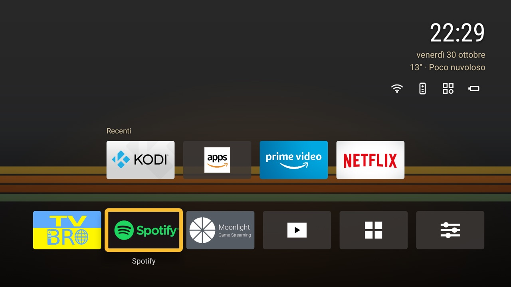
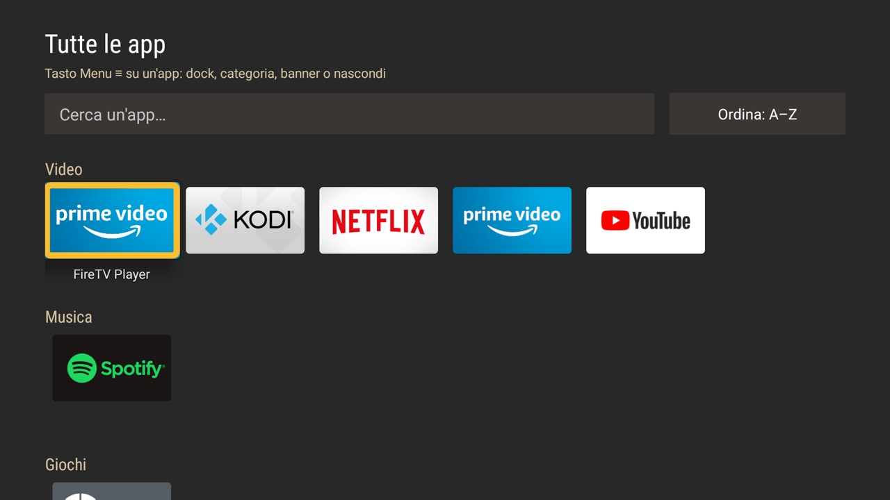
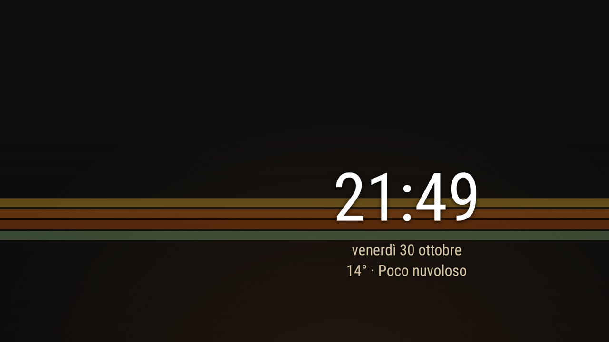

# NTSFireTV

A minimal, lightweight launcher for the **Amazon Fire TV Stick 4K**, inspired by the Apple TV interface.
No telemetry, no ads, no third-party runtime libraries: plain Kotlin and Android framework views.



> ⚠️ Personal project, tested only on the Fire TV Stick 4K (1st gen, *mantis*) with Fire OS 6.7.1.1.
> The user interface is currently **Italian only** (translations are welcome).
>
> NTSFireTV is not affiliated with, endorsed by or sponsored by Amazon. Fire TV is a trademark of Amazon.com, Inc.

## Features

- **Home** with full-screen wallpaper, clock, date and optional weather ([Open-Meteo](https://open-meteo.com), off by default)
- **Dock** with your favourite apps, reorderable with the remote, plus a **Recent** row and "Continue watching"
- **Home button** that brings you back to NTSFireTV instead of the Amazon home (no root needed)
- **All apps** grouped by category (Video, Music, Games, Tools, Other), sortable by name, usage or recency, with search
- **Quick shortcuts** to the Fire OS network, remotes/Bluetooth, apps and device settings
- **Themes**: colours, fonts, tile style and generated wallpapers, editable on the TV or as JSON files
- **Wallpapers** from internal storage or a USB drive, with an optional night wallpaper
- **USB video browser**: plays files in VLC and remembers where you stopped ("Resume")
- **Now Playing** widget with play/pause/next for Spotify and other media apps
- **Screensaver** in the style of the active theme
- **Backup and restore** of all settings to a file
- **Debloat tools**: Gradle tasks to disable Amazon telemetry, ads and unused services (reversible)

| All apps | Screensaver |
|---|---|
|  |  |

## Recommended apps

NTSFireTV doesn't include a player or browser: it relies on external apps, mostly open source.

| Use | App |
|---|---|
| Browser | [TV Bro](https://github.com/truefedex/tv-bro) (installed automatically by `installStick`) |
| Local videos | [VLC](https://www.videolan.org/vlc/) |
| Game/desktop streaming from a PC | [Moonlight](https://moonlight-stream.org) on the stick + [Sunshine](https://github.com/LizardByte/Sunshine) on the PC |
| Music | Spotify |

## Installation

There are no prebuilt APKs: NTSFireTV is built from source and installed over ADB with one Gradle task.

### Requirements

- A Fire TV Stick with Fire OS 6 or later
- A computer (macOS, Linux or Windows) with **JDK 17** and the **Android SDK** (compileSdk 36),
  e.g. from Android Studio or IntelliJ IDEA; `adb` comes with the SDK platform-tools
- The Fire TV and the computer on the same network

### 1. Prepare the Fire TV

1. Settings → My Fire TV → **Developer options**
2. Turn on **ADB debugging** and **Apps from unknown sources**

If "Developer options" is missing: Settings → My Fire TV → About, then click the device name 7 times.

### 2. Find the Fire TV IP address

Settings → My Fire TV → About → **Network** → "IP Address".

### 3. Build and install

```bash
git clone https://github.com/NtsCiccio/NTSFireTV.git
cd NTSFireTV
./gradlew installStick -Pstick=<IP-FIRE-TV>:5555      # Windows: gradlew.bat installStick -Pstick=...
```

On the first connection the TV shows a prompt: choose **Allow** (tick "Always allow from this computer").

`installStick` builds the app, installs it, installs the TV Bro browser if missing, grants all the permissions,
sets the NTSFireTV screensaver and opens the home. It also **debloats** the stick (disables Amazon telemetry,
ads and unused services, reversible with `./gradlew restoreBloat`): add `-Pdebloat=false` to skip it.
See [tools/README.md](tools/README.md) for the full list.

From now on the Home button goes back to NTSFireTV, even after a reboot.
The status of each permission is shown in **NTSFireTV → Impostazioni** (Settings).

### Permissions granted by `installStick`

Fire OS doesn't let you change the home app or grant some permissions from its settings,
so they are granted over ADB. If you install the APK another way, grant them by hand:

```bash
# Home button brings you back to NTSFireTV
adb shell appops set it.ntsciccio.ntsfiretv GET_USAGE_STATS allow
# Wallpapers and videos from internal storage and USB drives
adb shell pm grant it.ntsciccio.ntsfiretv android.permission.READ_EXTERNAL_STORAGE
adb shell pm grant it.ntsciccio.ntsfiretv android.permission.WRITE_EXTERNAL_STORAGE
# "Now Playing" widget (replaces the list: if `settings get secure enabled_notification_listeners`
# isn't empty, append this component to it separated by ":")
adb shell settings put secure enabled_notification_listeners it.ntsciccio.ntsfiretv/it.ntsciccio.ntsfiretv.system.NowPlayingListenerService
```

See [docs/DEVELOPMENT.md](docs/DEVELOPMENT.md) for all Gradle tasks, themes, a signed release build
for your own stick, and troubleshooting.

## Contributing

Issues and pull requests are welcome: see [CONTRIBUTING.md](CONTRIBUTING.md).
To report a security problem, see [SECURITY.md](SECURITY.md).

## License

[GPL-3.0-or-later](LICENSE). The external apps mentioned above each have their own license.
